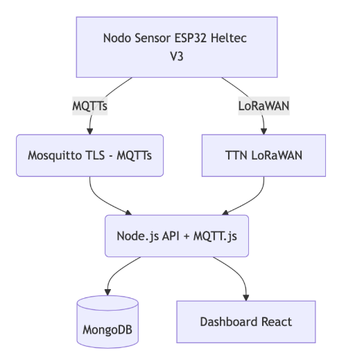

# Sistema de Monitoreo de Calidad del Aire (SMCA)

**Autor:** Ing. Rodrigo J. Pinedo Nava · **Carrera de Especialización en Internet de las Cosas (FIUBA)** · 2026

Sistema IoT de extremo a extremo: nodos ESP32-S3 con sensores de partículas y gases publican por **MQTT con TLS mutuo**; un backend Node.js valida cada lectura, calcula el **AQI (EPA)** y la guarda en MongoDB; un dashboard React muestra los datos con **aislamiento por empresa** y una vista pública opcional.

| Recurso | Enlace |
|---|---|
| Sitio con demo y arquitectura | carpeta [`portfolio/`](portfolio/) (desplegado en Vercel) |
| Video del proyecto | https://www.youtube.com/watch?v=WSZIAruJqQc |
| Video de la defensa | https://drive.google.com/file/d/1ci5M1UneZ5V-260mvkOnA0B-nq1ydaxN/view |
| Memoria (PDF) | https://lse-posgrados-files.fi.uba.ar/tesis/LSE-FIUBA-Trabajo-Final-CEIoT-Rodrigo-Jurgen-Pinedo-Nava-2026.pdf |
| Presentación (PDF) | https://lse-posgrados-files.fi.uba.ar/tesis/LSE-FIUBA-Trabajo-Final-CEIoT-Rodrigo-Jurgen-Pinedo-Nava-2026-Presentacion.pdf |
| Firmware del nodo | https://github.com/rodri-iot/IoT_SMCA_Firmware |

> La versión presentada en la defensa está en el tag **`v1.0-defensa`** (`git checkout v1.0-defensa`). Desde entonces el repositorio suma el sitio `portfolio/` y mejoras de replicabilidad; el sistema en sí no cambió.

## Arquitectura



```
Nodo ESP32 ──MQTTS :8883 (mTLS)──► Mosquitto ──► Backend (MQTT.js) ──► MongoDB
                                                    │
                                   API REST + SSE ◄─┘──► Dashboard React / Vista pública
```

Detalle de cada capa, con diagramas, en el sitio (`/sistema` y `/firmware`) y en [`docs/`](docs/):
[arquitectura de software](docs/arquitectura_software.md) · [backend](docs/arquitectura_backend.md) · [frontend](docs/arquitectura_frontend.md) · [base de datos](docs/diseno_base_de_datos.md) · [tópicos MQTT](docs/mqtt_estructura_topicos.md) · [despliegue](docs/despliegue.md).

## Estructura del repositorio

```
backend/     API Node.js + Express, cliente MQTT, modelos Mongoose, scripts de simulación
frontend/    Dashboard React + Vite (el sistema real, con login y roles)
mqtt/        Mosquitto con TLS mutuo y generador de certificados
portfolio/   Sitio estático de presentación + demo con datos simulados (Colegiales, CABA)
scripts/     setup-local.sh: prepara secretos, certificados, ACL y usuarios del broker
docs/        Documentación técnica
```

## Levantar el stack completo (Docker)

Requisitos: Docker con Compose, Node.js 18+ y `openssl`.

```bash
git clone https://github.com/rodri-iot/IoT_Sistema_Monitoreo_Calidad_Aire.git
cd IoT_Sistema_Monitoreo_Calidad_Aire

./scripts/setup-local.sh        # .env, JWT_SECRET, CA y certificados, ACL, usuarios del broker
docker compose up -d --build    # MongoDB + Mosquitto + backend

# Usuario inicial (superadmin). Cambiar la contraseña tras el primer ingreso.
docker compose exec backend mkdir -p /app/scripts
docker cp backend/scripts/create-admin.js backend:/app/scripts/
docker compose exec backend node /app/scripts/create-admin.js

cd frontend && npm install && npm run dev      # http://localhost:5173
```

| Servicio | URL |
|---|---|
| Dashboard | http://localhost:5173 |
| API REST | http://localhost:3000/api |
| Mosquitto (mTLS) | mqtts://localhost:8883 |

Sin hardware, se puede publicar lecturas simuladas con los scripts de [`backend/scripts/`](backend/scripts/) (ver [`docs/guia_simulacion_mqtt.md`](docs/guia_simulacion_mqtt.md)).
Para nodos físicos: emitir un certificado por nodo (`DEVICES` en `.env.local`), flashear el [firmware](https://github.com/rodri-iot/IoT_SMCA_Firmware) con su `config.h` y registrar el dispositivo (mismo `sensorId` que el CN) desde el dashboard.

> `.env`, `.env.local`, `mqtt/certs/`, `backend/certs/`, `mqtt/config/acl` y `mqtt/config/passwords` **no se versionan**; `scripts/setup-local.sh` los genera.

## Sitio estático y demo (`portfolio/`)

Los nodos no transmiten de forma continua, así que el sitio público no depende del backend: una demo con datos **simulados** de Colegiales (CABA), generados en el navegador con la misma escala AQI del sistema real, más las páginas de arquitectura del sistema y del firmware.

```bash
cd portfolio
npm install
npm run dev      # http://localhost:5174
npm run build    # genera dist/ (estático)
```

Despliegue en Vercel: proyecto con *Root Directory* = `portfolio` (el `vercel.json` ya define el rewrite de la SPA).

## Despliegues documentados

- Local con Docker (arriba).
- [Raspberry Pi](docs/deploy/despliegue-raspberry.md).
- AWS: [EC2](docs/deploy/despliegue-aws-ec2.md) + [S3/CloudFront](docs/deploy/despliegue-frontend-s3-cloudfront.md) + [HTTPS con Caddy](docs/deploy/https-443-backend-caddy.md) (versión de la defensa; ya no está activa).

## Licencia

Ver [LICENSE](LICENSE).
