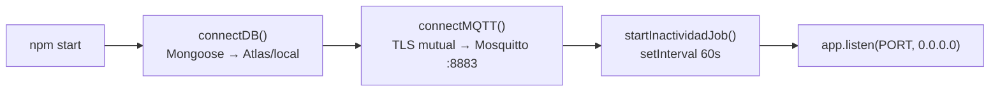
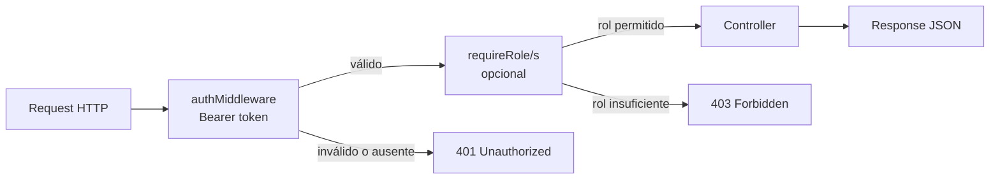
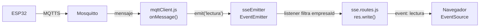
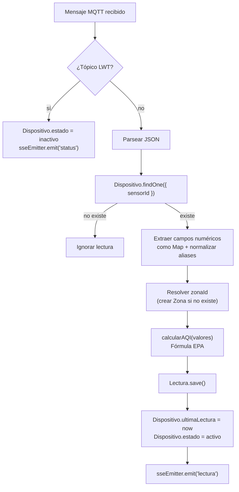
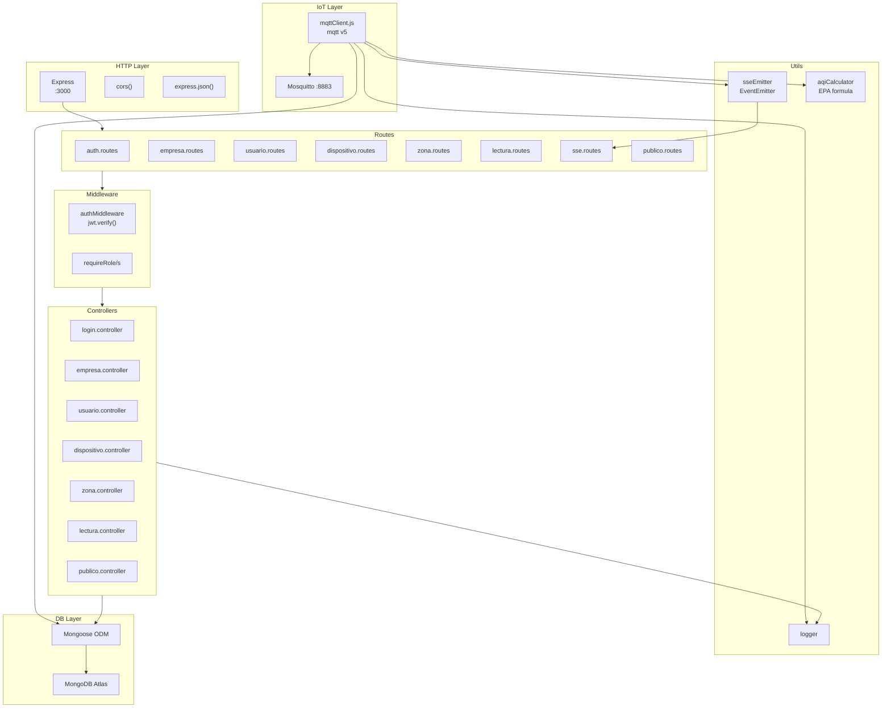

# Arquitectura del Backend — SMCA

**Sistema de Monitoreo de Calidad de Aire**
Trabajo Final — Maestría en Ingeniería de Sistemas IoT, UBA

---

## 1. Stack tecnológico

| Paquete | Versión | Rol |
|---|---|---|
| **Node.js** | 18 | Runtime de JavaScript en servidor |
| **Express** | ^4.18 | Framework HTTP para la API REST |
| **Mongoose** | ^7.5 | ODM (Object Document Mapper) para MongoDB |
| **mqtt** | ^5.3 | Cliente MQTT para suscripción al broker Mosquitto |
| **jsonwebtoken** | ^9.0 | Generación y verificación de tokens JWT |
| **bcrypt** | ^6.0 | Hash seguro de contraseñas |
| **cors** | ^2.8 | Middleware de Cross-Origin Resource Sharing |
| **dotenv** | ^16 | Carga de variables de entorno desde `.env` |

El backend es un proceso único Node.js que combina tres responsabilidades en el mismo runtime: servidor HTTP (REST + SSE), cliente MQTT y escritura a base de datos. No hay workers separados ni colas de mensajes.

---

## 2. Estructura de carpetas

```
backend/
├── DockerFile
├── env.example
├── package.json
├── scripts/               ← utilidades de administración y simulación
└── src/
    ├── server.js          ← entry point: Express + arranque
    ├── db/
    │   ├── connection.js  ← conexión Mongoose a MongoDB
    │   ├── Empresa.js     ← modelo empresas
    │   ├── Usuario.js     ← modelo usuarios
    │   ├── Zona.js        ← modelo zonas
    │   ├── Dispositivo.js ← modelo dispositivos
    │   └── Lectura.js     ← modelo lecturas (Map pattern)
    ├── mqtt/
    │   └── mqttClient.js  ← cliente MQTT con TLS mutual
    ├── routes/            ← definición de rutas (8 archivos)
    │   ├── auth.routes.js
    │   ├── empresa.routes.js
    │   ├── usuario.routes.js
    │   ├── dispositivo.routes.js
    │   ├── zona.routes.js
    │   ├── lectura.routes.js
    │   ├── sse.routes.js
    │   └── publico.routes.js
    ├── controllers/       ← lógica de negocio (7 archivos)
    │   ├── login.controller.js
    │   ├── empresa.controller.js
    │   ├── usuario.controller.js
    │   ├── dispositivo.controller.js
    │   ├── zona.controller.js
    │   ├── lectura.controller.js
    │   └── publico.controller.js
    ├── middleware/
    │   └── authMiddleware.js  ← verificación JWT + control de roles
    └── utils/
        ├── logger.js          ← log con timestamp ISO
        ├── sseEmitter.js      ← EventEmitter singleton para SSE
        └── aqiCalculator.js   ← cálculo AQI según fórmula EPA
```

---

## 3. Inicialización del servidor

El entry point es [`backend/src/server.js`](../backend/src/server.js). La función `startServer()` ejecuta los pasos en orden:



Si `connectDB()` falla, el proceso termina con `process.exit(1)`, evitando que el backend arranque sin base de datos.

**Middleware global registrado en Express:**

| Middleware | Función |
|---|---|
| `express.json()` | Parsea cuerpos JSON en las peticiones |
| `cors()` | Habilita CORS con configuración por defecto |

**Job de inactividad** (`startInactividadJob`): cada 60 segundos, ejecuta `Dispositivo.updateMany` para marcar como `inactivo` todo dispositivo cuyo campo `ultimaLectura` sea anterior a 5 minutos. Esto complementa el mecanismo LWT de MQTT para detectar dispositivos caídos sin desconexión limpia.

---

## 4. Mapa de endpoints

### Prefijos registrados en `server.js`

| Prefijo | Router |
|---|---|
| `/api` | `auth.routes`, `usuario.routes` |
| `/api/empresas` | `empresa.routes` |
| `/api/dispositivos` | `dispositivo.routes` |
| `/api/zonas` | `zona.routes` |
| `/api/lecturas` | `lectura.routes` |
| `/api/sse` | `sse.routes` |
| `/api/publico` | `publico.routes` |
| `/ping` | Inline (health check) |

### Endpoints completos

| Método | Path | Auth | Rol mínimo | Descripción |
|---|---|---|---|---|
| `GET` | `/ping` | No | — | Health check; responde `pong` |
| `POST` | `/api/login` | No | — | Login: `correo` + `password` → JWT + datos de usuario |
| `POST` | `/api/empresas/` | Bearer JWT | `superadmin` | Crea empresa + usuario administrador inicial |
| `GET` | `/api/empresas/admin/empresas` | Bearer JWT | `superadmin` | Lista todas las empresas con sus usuarios |
| `GET` | `/api/usuarios` | Bearer JWT | `admin` | Lista usuarios de la empresa; `superadmin` puede filtrar por `?empresaId=` |
| `POST` | `/api/usuarios` | Bearer JWT | `admin` | Crea usuario en la empresa del token |
| `GET` | `/api/usuarios/me` | Bearer JWT | cualquiera | Perfil del usuario autenticado |
| `PUT` | `/api/usuarios/:id` | Bearer JWT | `admin` | Edita usuario (solo dentro de la misma empresa) |
| `DELETE` | `/api/usuarios/:id` | Bearer JWT | `admin` | Elimina usuario (solo dentro de la misma empresa) |
| `GET` | `/api/dispositivos/` | Bearer JWT | cualquiera | Lista dispositivos; `superadmin` ve todos, resto ve los de su empresa |
| `POST` | `/api/dispositivos/` | Bearer JWT | `admin` | Registra nuevo dispositivo con `sensorId`, zona, ubicación |
| `PUT` | `/api/dispositivos/:id` | Bearer JWT | `admin` | Actualiza datos del dispositivo |
| `DELETE` | `/api/dispositivos/:id` | Bearer JWT | `admin` | Elimina dispositivo |
| `GET` | `/api/zonas/publicas` | No | — | Zonas marcadas como públicas + estadísticas 24h |
| `GET` | `/api/zonas/` | Bearer JWT | cualquiera | Zonas de la empresa + estadísticas |
| `POST` | `/api/zonas/` | Bearer JWT | `admin` | Crea zona con nombre, descripción y límites AQI |
| `PUT` | `/api/zonas/:id` | Bearer JWT | `admin` | Edita zona (solo si pertenece a la empresa del token) |
| `DELETE` | `/api/zonas/:id` | Bearer JWT | `admin` | Elimina zona (solo si pertenece a la empresa del token) |
| `GET` | `/api/lecturas/ultimas` | Bearer JWT | cualquiera | Últimas lecturas de la empresa |
| `GET` | `/api/lecturas/desde` | Bearer JWT | cualquiera | Lecturas desde fecha con paginación |
| `GET` | `/api/lecturas/sensor/:sensorId` | Bearer JWT | cualquiera | Historial de un sensor (verifica que pertenezca a la empresa) |
| `GET` | `/api/lecturas/agregadas` | Bearer JWT | cualquiera | Promedio por intervalo temporal (`$dateTrunc`) |
| `GET` | `/api/lecturas/estadisticas-zona` | Bearer JWT | cualquiera | Estadísticas por zona en ventana temporal |
| `GET` | `/api/lecturas/pico-dispositivos` | Bearer JWT | cualquiera | AQI pico por dispositivo en ventana temporal |
| `GET` | `/api/sse/lecturas?token=<JWT>` | JWT en query | cualquiera | Stream SSE en tiempo real (ver §9) |
| `GET` | `/api/publico/empresas` | No | — | Empresas con dispositivos públicos |
| `GET` | `/api/publico/dispositivos?empresaId=` | No | — | Dispositivos públicos de una empresa |
| `GET` | `/api/publico/agregadas` | No | — | Datos agregados de sensor público |
| `GET` | `/api/publico/lecturas` | No | — | Lecturas de sensor público |

---

## 5. Middleware de autenticación y autorización

El archivo [`backend/src/middleware/authMiddleware.js`](../backend/src/middleware/authMiddleware.js) exporta tres funciones:

### `authMiddleware`

Verifica el token JWT en el header `Authorization: Bearer <token>`. Si es válido, setea `req.user` con el payload decodificado (`id`, `correo`, `rol`, `empresaId`) y llama a `next()`.

```
Header: Authorization: Bearer eyJhbGci...
           ↓
     jwt.verify(token, JWT_SECRET)
           ↓
     req.user = { id, correo, rol, empresaId }
           ↓
     next()
```

### `requireRole(rol)` y `requireRoles([roles])`

Middleware factory que verifica si `req.user.rol` coincide con el/los roles permitidos. Se usa después de `authMiddleware`.

### Flujo completo de autorización



### Caso especial: SSE

El endpoint SSE (`/api/sse/lecturas`) no usa `authMiddleware` porque el browser no puede enviar headers custom en una conexión `EventSource`. En su lugar, el token se recibe como query parameter `?token=<JWT>` y se verifica manualmente dentro del handler de la ruta.

---

## 6. Autenticación JWT

**Flujo de login** (`login.controller.js`):

```
POST /api/login  { correo, password }
       ↓
  Usuario.findOne({ correo }).populate('empresa')
       ↓
  bcrypt.compare(password, usuario.password)
       ↓
  jwt.sign(
    { id, correo, rol, empresaId: empresa._id },
    JWT_SECRET,
    { expiresIn: '8h' }
  )
       ↓
  Response: { token, usuario: { id, correo, rol, empresa, empresaId } }
```

**Payload del token:**

| Campo | Tipo | Fuente |
|---|---|---|
| `id` | ObjectId | `usuario._id` |
| `correo` | String | `usuario.correo` |
| `rol` | String | `usuario.rol` |
| `empresaId` | ObjectId | `usuario.empresa._id` (populate) |

El `empresaId` en el token es la base del sistema multi-tenant: todos los controladores lo usan para filtrar datos.

---

## 7. Control de acceso por roles

El sistema tiene tres roles con permisos incrementales:

| Rol | Descripción | Recursos accesibles |
|---|---|---|
| `supervisor` | Acceso de solo lectura | Lee zonas, dispositivos, lecturas de su empresa |
| `admin` | Administrador de empresa | Todo lo de supervisor + CRUD de usuarios, dispositivos y zonas de su empresa |
| `superadmin` | Administrador global | Todo lo de admin + gestión de empresas + visibilidad de todas las empresas |

**Rutas públicas** (sin autenticación): `/api/login`, `/api/zonas/publicas`, todos los endpoints de `/api/publico/*`, `/ping`.

---

## 8. Multi-tenancy

El aislamiento entre empresas se implementa en los controladores con el siguiente patrón:

```js
// Patrón en controladores (ejemplo simplificado)
const empresaId = req.user.empresaId
const filter = req.user.rol === 'superadmin' ? {} : { empresaId }
const resultados = await Lectura.find(filter).sort({ timestamp: -1 })
```

**Reglas por recurso:**

| Recurso | `superadmin` | `admin` / `supervisor` |
|---|---|---|
| Empresas | Ve y gestiona todas | Solo la propia |
| Usuarios | Ve todos (con filtro `?empresaId=`) | Solo los de su empresa |
| Zonas | Ve y edita todas | Solo las de su empresa (`zona.empresaId === req.user.empresaId`) |
| Dispositivos | Ve y edita todos | Solo los de su empresa (`dispositivo.empresa === req.user.empresaId`) |
| Lecturas | Ve todas | Solo las de su empresa (`lectura.empresaId === req.user.empresaId`) |

El campo `empresaId` en `Lectura` está desnormalizado (copiado desde `Dispositivo.empresa` al momento de ingestar), lo que permite filtrar lecturas directamente sin join.

---

## 9. SSE — Server-Sent Events

El sistema usa SSE para enviar lecturas en tiempo real al dashboard sin que el frontend tenga que hacer polling.

### Arquitectura del pipeline SSE



### Endpoint

```
GET /api/sse/lecturas?token=<JWT>
```

### Headers de respuesta

```
Content-Type: text/event-stream
Cache-Control: no-cache
Connection: keep-alive
X-Accel-Buffering: no   ← evita buffering en Nginx/Caddy
```

### Eventos emitidos

| Evento | Filtro | Payload |
|---|---|---|
| `lectura` | Solo si `data.empresaId === decoded.empresaId` | `{ sensorId, empresaId, zonaId, zona, aqi, aqiParametro, timestamp, valores }` |
| `status` | Sin filtro (todos los suscriptores) | `{ sensorId, estado }` |

### Heartbeat y limpieza

- Cada 30 segundos se envía un comentario SSE (`: heartbeat`) para mantener la conexión TCP activa.
- Al cierre del cliente (`req.on('close')`), se eliminan los listeners y se limpia el intervalo para evitar memory leaks.
- El `EventEmitter` tiene `maxListeners(50)` para soportar hasta 50 clientes SSE concurrentes.

---

## 10. Cliente MQTT

El archivo [`backend/src/mqtt/mqttClient.js`](../backend/src/mqtt/mqttClient.js) conecta al broker Mosquitto con TLS mutual y procesa mensajes de forma asíncrona.

### Conexión

```js
mqtt.connect(process.env.MQTT_HOST, {
  clientId: process.env.CLIENT_ID,
  rejectUnauthorized: true,
  ca:   fs.readFileSync(process.env.CA_CERT),
  cert: fs.readFileSync(process.env.CLIENT_CERT),
  key:  fs.readFileSync(process.env.CLIENT_KEY)
})
```

Se suscribe a dos tópicos: `MQTT_TOPIC` (lecturas) y `MQTT_TOPIC_LWT` (estado/desconexión).

### Pipeline de procesamiento de mensaje de lectura



### Normalización de aliases

El backend traduce variantes de nombres de parámetros a sus nombres canónicos:

| Alias aceptados | Nombre canónico |
|---|---|
| `temp`, `temperature`, `temperatura` | `temperatura` |
| `hum`, `humidity`, `humedad` | `humedad` |

Todos los demás campos numéricos se almacenan con el nombre que llegue en el payload.

---

## 11. Calculador AQI

El archivo [`backend/src/utils/aqiCalculator.js`](../backend/src/utils/aqiCalculator.js) implementa el índice AQI según la fórmula de la EPA de Estados Unidos.

### Fórmula

```
Ip = ((Ihigh - Ilow) / (BPhigh - BPlow)) × (Cp - BPlow) + Ilow
```

Donde `Cp` es la concentración medida, `BPlow`/`BPhigh` son los límites del tramo, e `Ilow`/`Ihigh` son los índices correspondientes.

### Parámetros soportados con breakpoints

| Parámetro | Unidad | Rango AQI |
|---|---|---|
| `pm25` | µg/m³ | 0 – 500 |
| `pm10` | µg/m³ | 0 – 500 |
| `no2` | ppb | 0 – 500 |
| `co` | ppm | 0 – 500 |

### Función principal

`calcularAQI(valores)` recibe el `Map` de mediciones, calcula el sub-índice para cada parámetro soportado y retorna el valor máximo junto con el parámetro dominante:

```js
{ aqi: 72, parametro: 'pm25' }
```

### Escala AQI

| Rango | Categoría |
|---|---|
| 0 – 50 | Bueno |
| 51 – 100 | Moderado |
| 101 – 150 | Dañino para grupos sensibles |
| 151 – 200 | Dañino |
| 201 – 300 | Muy dañino |
| 301 – 500 | Peligroso |

---

## 12. Puerto, red y CORS

### Puerto HTTP

```js
const PORT = process.env.PORT || 3000
app.listen(PORT, '0.0.0.0', ...)  // escucha en todas las interfaces
```

### CORS

```js
app.use(cors())  // configuración por defecto
```

Con la configuración por defecto, `cors()` refleja el origen de la petición y permite todos los métodos. No hay restricción de dominio explícita en el código; en producción se delega al reverse proxy (Caddy) para controlar el acceso por dominio.

### Conexiones del backend

| Protocolo | Host | Puerto | Dirección | Propósito |
|---|---|---|---|---|
| HTTP/HTTPS | `0.0.0.0` | `3000` | Entrada | API REST + SSE |
| MQTTS | `mosquitto` | `8883` | Salida | Suscripción al broker MQTT |
| MongoDB | `mongo` / Atlas | `27017` / `27017 SRV` | Salida | Lectura y escritura de datos |

---

## 13. Utilidades

### `logger.js`

Wrapper sobre `console.log` que agrega un timestamp ISO 8601 a cada línea:

```
[2026-04-19T14:30:00.123Z] Lectura guardada: nodo01 (5 parámetros) AQI: 72
```

### `sseEmitter.js`

`EventEmitter` singleton exportado como módulo. Al ser un módulo Node.js, se carga una única instancia para todo el proceso, permitiendo que `mqttClient.js` y `sse.routes.js` compartan el mismo emitter sin acoplamiento directo.

```js
const EventEmitter = require('events')
const emitter = new EventEmitter()
emitter.setMaxListeners(50)
module.exports = emitter
```

---

## 14. Diagrama de componentes del backend


