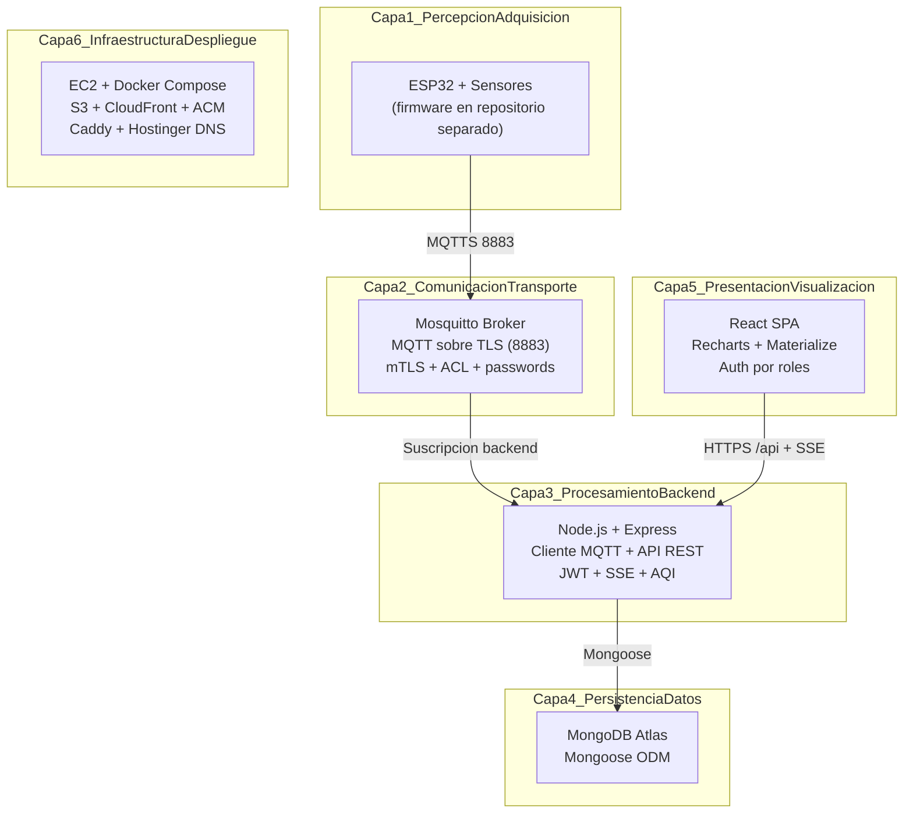
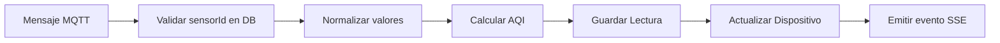
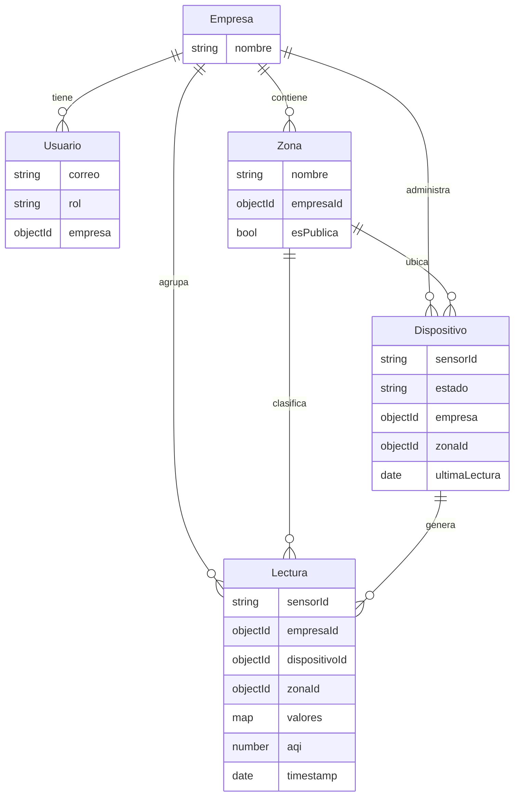
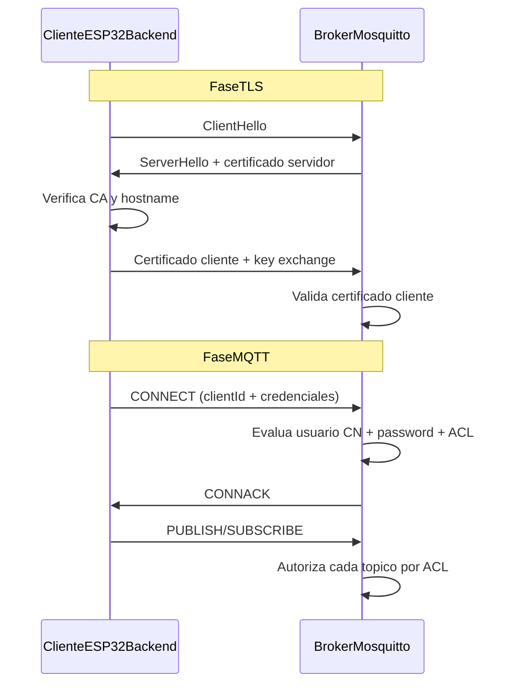
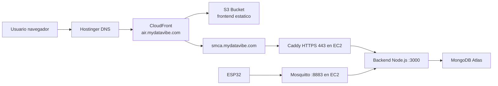
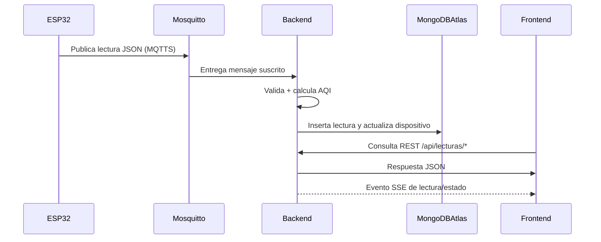

# Arquitectura de Software SMCA por Capas

## 3.1. Diseno general del sistema IoT

El Sistema de Monitoreo de Calidad de Aire (SMCA) sigue una arquitectura modular y desacoplada, organizada por capas funcionales. Esta organizacion permite separar responsabilidades, facilitar el mantenimiento y habilitar la evolucion independiente de cada modulo.

La arquitectura se estructura en seis capas:

1. Percepcion y adquisicion (firmware en ESP32)
2. Comunicacion y transporte (MQTT sobre TLS)
3. Procesamiento y logica de negocio (backend)
4. Persistencia de datos (MongoDB)
5. Presentacion y visualizacion (frontend web)
6. Infraestructura y despliegue (AWS + DNS + CDN)



### Tabla resumen de capas

| Capa | Tecnologias principales | Responsabilidad | Ubicacion de despliegue |
|---|---|---|---|
| Percepcion | ESP32 + sensores (PMS7003, CJMCU-4541, SCD40) | Captura de variables ambientales y envio de telemetria | Dispositivo edge |
| Comunicacion | Mosquitto 2.0, MQTT, TLS/mTLS | Transporte seguro de mensajes pub/sub | EC2 (contenedor Docker) |
| Procesamiento | Node.js, Express, mqtt.js, JWT, SSE | Ingesta MQTT, reglas de negocio, API REST, eventos en tiempo real | EC2 (contenedor Docker) |
| Persistencia | MongoDB Atlas, Mongoose | Almacenamiento de entidades y lecturas historicas | MongoDB Atlas |
| Presentacion | React, Vite, Recharts, Materialize | Visualizacion, gestion y monitoreo web | S3 + CloudFront |
| Infraestructura | AWS EC2, S3, CloudFront, ACM, Hostinger DNS | Orquestacion, disponibilidad, seguridad HTTPS y ruteo | AWS + Hostinger |

## 3.2. Diseno e implementacion del firmware (ESP32)

El firmware se mantiene en un repositorio independiente del backend/frontend. Esta separacion refuerza la modularidad del sistema y permite ciclos de desarrollo diferentes para software embebido y software de plataforma.

### Funciones del modulo embebido

- Inicializacion de conectividad Wi-Fi.
- Conexion segura al broker MQTT con `mqtts://<host>:8883`.
- Carga de `ca.crt`, `client.crt` y `client.key`.
- Simulacion y/o adquisicion real de sensores.
- Publicacion periodica de telemetria en formato JSON.
- Definicion de mensaje LWT para estado del dispositivo.

### Estructura de mensaje de telemetria

Ejemplo de payload publicado por un nodo:

```json
{
  "sensorId": "esp32-air-001",
  "timestamp": "2026-03-27T21:53:54Z",
  "pm25": 26.00,
  "pm10": 27.00,
  "co": 0.00,
  "no2": 0.000,
  "nh3": 0.000,
  "tvoc": 0
}
```

## 3.3. Diseno e implementacion del backend

El backend funciona como capa de integracion central. Expone API REST para frontend, consume mensajes MQTT desde Mosquitto y persiste resultados en MongoDB Atlas.

### Componentes principales

- **Servidor Express**: entrada de la aplicacion, middlewares, montaje de rutas y arranque.
- **Cliente MQTT**: suscripcion a topicos de telemetria y estado, procesamiento de mensajes.
- **Capa de autenticacion/autorizacion**: JWT + control de roles (`superadmin`, `admin`, `supervisor`).
- **Capa de persistencia**: modelos Mongoose y acceso a base de datos.
- **Canal de tiempo real**: endpoint SSE para actualizaciones de lecturas/estado.
- **Servicios de negocio**: calculo AQI y job de inactividad de dispositivos.

### Flujo interno de ingesta MQTT



### Endpoints REST por dominio

- **Autenticacion**: `POST /api/login`
- **Empresas**: `POST /api/empresas`, `GET /api/empresas/admin/empresas`
- **Usuarios**: `GET/POST /api/usuarios`, `PUT/DELETE /api/usuarios/:id`, `GET /api/usuarios/me`
- **Zonas**: `GET /api/zonas/publicas`, `GET/POST/PUT/DELETE /api/zonas`
- **Dispositivos**: `GET/POST/PUT/DELETE /api/dispositivos`
- **Lecturas**: endpoints de ultimas, desde, agregadas, estadisticas y picos
- **Publico**: endpoints `/api/publico/*`
- **SSE**: `GET /api/sse/lecturas?token=<jwt>`

## 3.4. Diseno e implementacion del frontend web

El frontend es una SPA React compilada con Vite. Su funcion es presentar informacion de monitoreo, permitir administracion por rol y mostrar datos en tiempo real.

### Caracteristicas tecnicas

- React 18 + React Router 6
- Materialize CSS para UI
- Recharts para visualizacion de series y metricas
- Luxon para manejo de fechas y zona horaria
- `AuthContext` para gestion de sesion y token JWT
- `ThemeContext` para cambio de tema

### Patron de comunicacion

- Peticiones HTTP con `fetch` a rutas relativas `/api/...`
- En desarrollo, Vite usa proxy hacia el backend
- En produccion, CloudFront reenvia `/api/*` al origen del backend
- SSE para actualizaciones de lecturas y estados sin polling agresivo

### Seguridad y control de acceso

Las vistas privadas se protegen con `RequireAuth` y una matriz de roles permitidos por ruta.

## 3.5. Diseno de la base de datos

La persistencia se implementa con MongoDB Atlas y Mongoose. El modelo prioriza flexibilidad para soportar parametros ambientales variables y consultas historicas/agregadas.

### Modelos principales

- `Empresa`
- `Usuario`
- `Zona`
- `Dispositivo`
- `Lectura`



### Criterios de diseno de datos

- El campo `valores` en `Lectura` usa tipo `Map` para admitir sensores/parametros heterogeneos.
- Se incluyen indices por `sensorId`, `timestamp`, `empresaId` y campos de consulta frecuente.
- Se conserva separacion entre datos operativos (dispositivo actual) e historicos (coleccion de lecturas).

## 3.6. Comunicacion IoT

La comunicacion IoT se basa en MQTT con seguridad TLS mutua.

### Configuracion de seguridad aplicada

- Listener MQTT seguro: puerto `8883`
- `require_certificate true` (mTLS obligatorio)
- `use_identity_as_username true` (CN del certificado como usuario MQTT)
- `allow_anonymous false`
- `password_file` y `acl_file` activos

### Topicos

- Topico legacy de lecturas: `iot/aire/lectura`
- Topico de estado/LWT: `iot/aire/status`
- Jerarquia por usuario/dispositivo: `smca/%u/#` y topicos derivados

### Secuencia TLS + MQTT



## 3.7. Despliegue del sistema en la nube

El sistema se despliega con una arquitectura distribuida entre servicios AWS y componentes externos de DNS.



### Componentes de despliegue

- **EC2**: ejecuta Docker Compose con backend y broker MQTT.
- **S3**: alojamiento estatico del frontend compilado.
- **CloudFront**: CDN y terminacion TLS del frontend; enruta `/api/*` al backend.
- **MongoDB Atlas**: base de datos gestionada externa a EC2.
- **Hostinger**: gestion de dominio y registros DNS.
- **Caddy en EC2**: terminacion TLS y reverse proxy para API backend.

## 3.8. Integracion del sistema y pruebas modulares

La integracion sigue el flujo extremo a extremo desde adquisicion hasta visualizacion.



### Enfoque de pruebas modulares

- **Firmware**: verificacion de conexion MQTT, publicacion periodica y formato de payload.
- **Broker MQTT**: validacion de autenticacion mTLS, credenciales y reglas ACL por topico.
- **Backend**: pruebas de rutas REST, autenticacion JWT, ingesta MQTT y calculo AQI.
- **Persistencia**: validacion de modelos, indices y consultas agregadas.
- **Frontend**: pruebas funcionales por vista, roles y comportamiento de SSE.
- **Integracion E2E**: trazabilidad de lectura desde ESP32 hasta dashboard.

El repositorio incluye scripts en `backend/scripts/` para simulacion de datos, validacion de conectividad MQTT y carga de datos iniciales, lo que facilita la verificacion modular e integrada.

## 3.9. Consideraciones de escalabilidad y mantenimiento

### Escalabilidad

1. **Escalado horizontal del frontend**: resuelto por naturaleza estatica en S3 + CloudFront.
2. **Escalado de base de datos**: delegable en MongoDB Atlas mediante tiers y configuraciones administradas.
3. **Escalado de backend**: posible mediante multiples instancias y balanceo, manteniendo API stateless con JWT.
4. **Escalado de dispositivos**: el patron pub/sub de MQTT simplifica crecimiento de nodos de adquisicion.

### Mantenibilidad

1. **Separacion por capas y repositorios**: firmware y plataforma evolucionan con bajo acoplamiento.
2. **Contratos claros de integracion**: topicos MQTT y payload JSON bien definidos.
3. **Seguridad centralizada**: certificados, ACL, roles y JWT como politicas explicitas.
4. **Observabilidad operativa**: logs de broker, backend y contenedores para diagnostico.

### Evolucion futura recomendada

- Incorporar pruebas automatizadas E2E continuas.
- Incorporar metricas y alertas centralizadas.
- Evaluar migracion de SSE a WebSocket en escenarios de mayor concurrencia bidireccional.
- Externalizar broker MQTT en arquitectura altamente disponible si aumenta la carga operativa.

## Conclusion

El SMCA presenta una arquitectura modular por capas, coherente con practicas de sistemas IoT modernos. La separacion de responsabilidades entre adquisicion, comunicacion, procesamiento, persistencia, visualizacion e infraestructura permite justificar academicamente el diseno adoptado y soporta crecimiento tecnico futuro sin redisenar el sistema completo.
