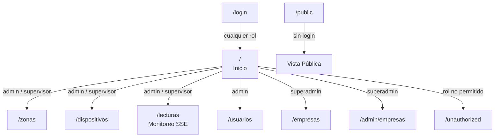
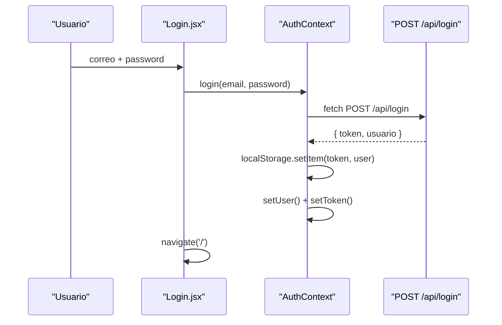
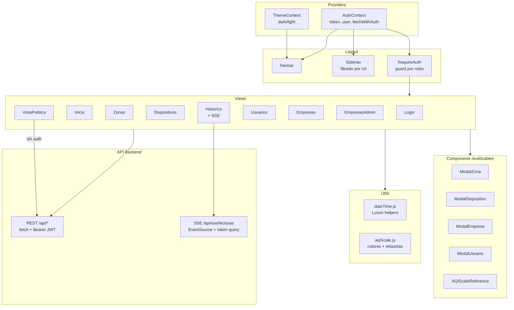

# Arquitectura del Frontend — SMCA

**Sistema de Monitoreo de Calidad de Aire**
Trabajo Final — Maestría en Ingeniería de Sistemas IoT, UBA

---

## 1. Stack tecnológico

| Paquete | Versión | Rol |
|---|---|---|
| **React** | ^18.2 | Librería de UI con componentes funcionales y hooks |
| **React Router DOM** | ^6.30 | Routing declarativo SPA (Single Page Application) |
| **Recharts** | ^3.7 | Gráficos interactivos: líneas, barras, áreas, pie |
| **Materialize CSS** | ^1.0 | Framework de UI (grids, cards, modals, formularios) |
| **Luxon** | ^3.5 | Manejo de fechas, zonas horarias y formateo |
| **Vite** | ^5.0 | Bundler y servidor de desarrollo con HMR |

**No se usa:** Axios (todo via `fetch` nativo), Redux/Zustand (solo Context API), React Query.

**Iconos:** Google Material Icons vía CDN en `index.html` (`<link>` a `fonts.googleapis.com`).

---

## 2. Estructura de carpetas

```
frontend/
├── DockerFile               ← imagen dev (npm run dev)
├── index.html               ← shell HTML (Vite entry)
├── package.json
├── vite.config.js           ← dev proxy + port
└── src/
    ├── main.jsx             ← entry point React, carga Materialize
    ├── App.jsx              ← BrowserRouter + providers + Routes
    ├── App.css              ← design tokens y variables CSS dark/light
    ├── context/
    │   ├── AuthContext.jsx  ← estado auth, login, logout, fetchWithAuth
    │   └── ThemeContext.jsx ← toggle dark/light, persistencia localStorage
    ├── components/
    │   ├── RequireAuth.jsx      ← route guard por rol
    │   ├── Navbar.jsx           ← barra superior, nombre empresa, tema
    │   ├── Sidenav.jsx          ← menú lateral filtrado por rol
    │   ├── ModalDispositivo.jsx ← CRUD dispositivos
    │   ├── ModalZona.jsx        ← CRUD zonas
    │   ├── ModalEmpresa.jsx     ← creación empresa + usuario inicial
    │   ├── ModalUsuario.jsx     ← edición usuario (Materialize modal)
    │   ├── AQIScaleReference.jsx       ← leyenda visual de escala AQI
    │   └── AqiPollutantLimitsNote.jsx  ← referencia EPA de límites
    ├── views/
    │   ├── Login.jsx        ← formulario de acceso
    │   ├── Inicio.jsx       ← bienvenida + info AQI
    │   ├── VistaPublica.jsx ← dashboard público sin autenticación
    │   ├── Zonas.jsx        ← gestión y stats de zonas
    │   ├── Dispositivos.jsx ← gestión y estado de dispositivos
    │   ├── Historico.jsx    ← monitoreo en tiempo real + histórico (SSE)
    │   ├── Usuarios.jsx     ← gestión de usuarios
    │   ├── Empresas.jsx     ← registro de nueva empresa (superadmin)
    │   ├── EmpresasAdmin.jsx ← panel de todas las empresas (superadmin)
    │   └── Unauthorized.jsx ← página de acceso denegado
    └── utils/
        ├── aqiScale.js              ← colores y etiquetas por rango AQI
        ├── aqiEpaReferenceText.js   ← textos de referencia EPA
        └── dateTime.js              ← helpers Luxon + zona horaria
```

---

## 3. Entry point y configuración

### `index.html`

Shell HTML mínima. Carga los íconos de Material vía CDN y monta el punto de entrada de React:

```html
<link href="https://fonts.googleapis.com/icon?family=Material+Icons" rel="stylesheet">
<div id="root"></div>
<script type="module" src="/src/main.jsx"></script>
```

### `main.jsx`

Importa Materialize CSS y JS, aplica el tema almacenado en `localStorage`, y monta la aplicación en `#root`:

```jsx
import 'materialize-css/dist/css/materialize.min.css'
import 'materialize-css/dist/js/materialize.min.js'

const storedTheme = localStorage.getItem('smca-theme') || 'dark'
document.documentElement.setAttribute('data-theme', storedTheme)

ReactDOM.createRoot(document.getElementById('root')).render(<App />)
```

### `vite.config.js`

Configura el servidor de desarrollo con proxy hacia el backend:

```js
proxy: {
  '/api/sse': {
    target: VITE_API_URL,
    // Deshabilita buffering para que SSE fluya sin delay
    configure: (proxy) => proxy.on('proxyRes', (res) => {
      res.headers['cache-control'] = 'no-cache'
      res.headers['x-accel-buffering'] = 'no'
    })
  },
  '/api': { target: VITE_API_URL }
}
```

Este proxy **solo aplica en desarrollo**. En producción el routing de `/api/*` es responsabilidad de CloudFront (behavior rules).

---

## 4. Routing y protección de rutas

### `App.jsx`

Envuelve la aplicación en los dos providers de contexto y define el árbol de rutas:

```jsx
<ThemeProvider>
  <AuthProvider>
    <BrowserRouter>
      <Navbar />
      <div className="app-shell">
        <Sidenav />
        <main>
          <Routes>
            {/* ... */}
          </Routes>
        </main>
      </div>
    </BrowserRouter>
  </AuthProvider>
</ThemeProvider>
```

### Mapa de rutas

| Ruta | Componente | Protección | Roles permitidos |
|---|---|---|---|
| `/login` | `Login` | Pública | — |
| `/public` | `VistaPublica` | Pública | — |
| `/unauthorized` | `Unauthorized` | Pública | — |
| `/` | `Inicio` | Protegida | `superadmin`, `admin`, `supervisor` |
| `/zonas` | `Zonas` | Protegida | `admin`, `supervisor` |
| `/dispositivos` | `Dispositivos` | Protegida | `admin`, `supervisor` |
| `/lecturas` | `Historico` | Protegida | `admin`, `supervisor` |
| `/usuarios` | `Usuarios` | Protegida | `admin` |
| `/empresas` | `Empresas` | Protegida | `superadmin` |
| `/admin/empresas` | `EmpresasAdmin` | Protegida | `superadmin` |

### Diagrama de navegación por rol



### `RequireAuth`

Componente guard que envuelve las rutas protegidas:

```jsx
export default function RequireAuth({ children, allowedRoles }) {
  const { user } = useContext(AuthContext)
  if (!user) return <Navigate to="/login" replace />
  if (!allowedRoles.includes(user.rol)) return <Navigate to="/unauthorized" replace />
  return children
}
```

---

## 5. Gestión de estado

El frontend usa **exclusivamente Context API** de React. No hay Redux, Zustand ni React Query.

| Contexto | Estado que gestiona |
|---|---|
| `AuthContext` | `user`, `token`, `login()`, `logout()`, `fetchWithAuth()` |
| `ThemeContext` | `theme` (`'dark'` / `'light'`), `toggleTheme()` |

El estado específico de cada vista (listas de dispositivos, lecturas, filtros, paginación) se maneja localmente con `useState` y `useEffect` dentro de cada componente de vista.

---

## 6. Autenticación en el frontend

### `AuthContext.jsx`

El contexto de autenticación centraliza toda la lógica de sesión.

**Flujo de login:**



**Persistencia de sesión:** al montar la aplicación, `AuthContext` lee `token` y `user` de `localStorage` para restaurar la sesión sin necesidad de hacer login nuevamente.

**Expiración automática:** cada 30 segundos se decodifica el campo `exp` del JWT (sin verificar firma) y si el token expiró, se llama a `logout()` y se redirige a `/login`. El backend emite tokens con `expiresIn: '8h'`.

**`fetchWithAuth(url, options)`**: wrapper sobre `fetch` que inyecta `Authorization: Bearer <token>` en todos los headers. Si la respuesta es `401`, llama a `logout()` y redirige a `/login` automáticamente.

```js
const fetchWithAuth = async (url, options = {}) => {
  const headers = { ...options.headers, Authorization: `Bearer ${token}` }
  const res = await fetch(url, { ...options, headers })
  if (res.status === 401) { logout(); window.location.href = '/login' }
  return res
}
```

### `ThemeContext.jsx`

Persiste el tema elegido en `localStorage` bajo la clave `smca-theme` y actualiza el atributo `data-theme` en `<html>` para activar las variables CSS del tema correspondiente.

---

## 7. SSE — Tiempo real en el frontend

Solo la vista `Historico.jsx` consume el stream SSE. El browser no soporta headers custom en `EventSource`, por lo que el token JWT se pasa como query parameter.

```js
// Dentro de Historico.jsx
useEffect(() => {
  if (!token) return
  const url = `/api/sse/lecturas?token=${encodeURIComponent(token)}`
  const es = new EventSource(url)

  es.addEventListener('lectura', (e) => {
    const data = JSON.parse(e.data)
    // Actualiza estado de dispositivos, picos AQI y dispara re-render
    setDispositivos(prev => prev.map(d =>
      d.sensorId === data.sensorId
        ? { ...d, ultimaLectura: data.timestamp, estado: 'activo' }
        : d
    ))
    setRefreshKey(k => k + 1)  // fuerza recarga de datos del gráfico
  })

  es.addEventListener('status', (e) => {
    const data = JSON.parse(e.data)
    // Actualiza estado online/offline del dispositivo
    setDispositivos(prev => prev.map(d =>
      d.sensorId === data.sensorId ? { ...d, estado: data.estado } : d
    ))
  })

  return () => es.close()  // limpieza al desmontar
}, [token])
```

**Eventos manejados:**

| Evento SSE | Acción en el frontend |
|---|---|
| `lectura` | Actualiza `ultimaLectura` y `estado` del dispositivo; actualiza picos AQI; incrementa `refreshKey` para recargar gráficos |
| `status` | Actualiza `estado` (activo/inactivo) del dispositivo sin recargar datos |

---

## 8. Vistas principales

### `/login` — Login

Formulario de correo y contraseña. Llama a `AuthContext.login()`. Si el usuario ya está autenticado, redirige a `/`. Muestra errores del backend debajo del formulario.

**API:** `POST /api/login`

---

### `/public` — Vista Pública

Dashboard sin autenticación para mostrar datos de sensores públicos. Permite seleccionar una empresa y ver sus dispositivos públicos con gráficos de las últimas 24 horas.

**Características:**
- Selector de empresa → carga dispositivos públicos
- Gráfico de línea con histórico de parámetros ambientales (Recharts `LineChart`)
- Indicador AQI con color según escala EPA
- Sin `fetchWithAuth`; usa `fetch` directo a `/api/publico/*`

**APIs:** `GET /api/publico/empresas`, `GET /api/publico/dispositivos?empresaId=`, `GET /api/publico/lecturas`, `GET /api/publico/agregadas`

---

### `/` — Inicio

Vista de bienvenida para usuarios autenticados. Muestra información sobre el sistema y la escala AQI. Incluye un link rápido a la vista de Monitoreo (`/lecturas`).

**Componentes usados:** `AQIScaleReference`, `AqiPollutantLimitsNote`

---

### `/zonas` — Zonas

Gestión de zonas de monitoreo con estadísticas en tiempo cuasi-real.

**Características:**
- Cards por zona con AQI promedio actual y número de dispositivos activos
- Gráfico de líneas multi-zona con histórico (Recharts `LineChart`)
- CRUD de zonas (crear, editar, eliminar) mediante `ModalZona` — solo `admin`/`superadmin`
- Configuración de límites AQI por zona (`bueno`, `moderado`, `peligroso`)

**APIs:** `GET /api/zonas`, `POST /api/zonas`, `PUT /api/zonas/:id`, `DELETE /api/zonas/:id`

---

### `/dispositivos` — Dispositivos

Gestión del inventario de sensores con indicadores de estado en tiempo cuasi-real.

**Características:**
- Selector de zona para filtrar dispositivos
- Tabla de dispositivos con estado (activo/inactivo), última lectura y AQI actual
- Indicador visual de conectividad MQTT por dispositivo
- Gráfico comparativo zona vs dispositivo (Recharts `BarChart` / `LineChart`)
- CRUD de dispositivos mediante `ModalDispositivo` — solo `admin`/`superadmin`
- `superadmin` puede asignar dispositivos a cualquier empresa

**APIs:** `GET /api/dispositivos`, `GET /api/zonas`, `GET /api/lecturas/pico-dispositivos`, `POST/PUT/DELETE /api/dispositivos/:id`

---

### `/lecturas` — Monitoreo (Historico.jsx)

Vista principal de monitoreo en tiempo real e histórico. Es la más compleja del frontend (~913 líneas).

**Características:**
- **SSE en tiempo real:** `EventSource` suscripto a `/api/sse/lecturas` actualiza dispositivos y AQI sin polling
- **Selector de dispositivo y rango de fechas** para consultas históricas
- **Gráficos interactivos** con Recharts: series de tiempo para cada parámetro (pm25, pm10, co2, temperatura, humedad)
- **Tabla de lecturas** con paginación
- **Exportación** a CSV/Excel de los datos filtrados
- **Panel de pico AQI** por dispositivo en el período seleccionado
- Selector de granularidad de agregación (hora, día)

**APIs:** `GET /api/lecturas/ultimas`, `GET /api/lecturas/desde`, `GET /api/lecturas/sensor/:sensorId`, `GET /api/lecturas/agregadas`, `GET /api/lecturas/estadisticas-zona`, `GET /api/lecturas/pico-dispositivos`, `GET /api/sse/lecturas?token=` (SSE)

---

### `/usuarios` — Usuarios

Gestión de usuarios de la empresa. Solo accesible para `admin`.

**Características:**
- Tabla de usuarios con correo y rol
- Crear usuario con rol `admin` o `supervisor`
- Editar usuario mediante `ModalUsuario` (Materialize modal)
- Eliminar usuario
- `superadmin` ve usuarios de todas las empresas con filtro por empresa

**APIs:** `GET /api/usuarios`, `POST /api/usuarios`, `PUT /api/usuarios/:id`, `DELETE /api/usuarios/:id`

---

### `/empresas` — Registro de Empresa

Formulario para que el `superadmin` registre una nueva empresa junto con su primer usuario administrador.

**Componente:** `ModalEmpresa` inline en la vista.

**API:** `POST /api/empresas`

---

### `/admin/empresas` — Panel de Empresas

Vista exclusiva para `superadmin` que lista todas las empresas registradas con sus usuarios asociados, estadísticas básicas y acciones de gestión.

**API:** `GET /api/empresas/admin/empresas`

---

## 9. Componentes reutilizables

| Componente | Propósito |
|---|---|
| `Navbar` | Barra superior: logo SMCA, nombre de empresa del usuario, toggle de tema, botón logout |
| `Sidenav` | Menú lateral: ítems filtrados según `user.rol`; oculto si no hay sesión activa |
| `RequireAuth` | Guard de rutas protegidas por rol (ver §4) |
| `ModalDispositivo` | Formulario de creación/edición de dispositivos con campos de zona, ubicación, `esPublico` |
| `ModalZona` | Formulario de creación/edición de zonas con límites AQI y flag `esPublica` |
| `ModalEmpresa` | Formulario de alta de empresa + usuario inicial |
| `ModalUsuario` | Edición de usuario usando el sistema de modales de Materialize (`M.Modal`) |
| `AQIScaleReference` | Barra visual de colores con los rangos AQI y sus etiquetas |
| `AqiPollutantLimitsNote` | Tabla de referencia EPA con los límites por contaminante |

---

## 10. Llamadas a la API

El frontend usa `fetch` nativo. No hay una capa de cliente HTTP centralizada (sin Axios, sin instancia global).

**Dos patrones de llamada:**

```js
// 1. Llamadas públicas (sin autenticación)
const res = await fetch('/api/publico/lecturas?sensorId=nodo01')
const data = await res.json()

// 2. Llamadas autenticadas (via fetchWithAuth del contexto)
const res = await fetchWithAuth('/api/zonas')
const data = await res.json()
```

**URLs relativas (`/api/...`):**
- En **desarrollo**: el proxy de Vite las redirige a `VITE_API_URL` (default `http://127.0.0.1:3000`).
- En **producción**: deben resolverse al backend. CloudFront maneja el routing de `/api/*` al dominio del backend (`smca.mydatavibe.com`).

---

## 11. Utilidades del frontend

### `dateTime.js`

Helpers basados en **Luxon** para el manejo consistente de fechas en todas las vistas:

```js
export function getAppTimeZone() {
  return import.meta.env.VITE_APP_TIMEZONE || 'America/Argentina/Buenos_Aires'
}
```

Provee funciones para formatear timestamps, calcular rangos de fecha, convertir entre zonas horarias y generar etiquetas para los ejes de los gráficos.

### `aqiScale.js`

Define los rangos AQI con sus colores y etiquetas para uso consistente en todos los componentes:

```js
// Ejemplo del patrón
{ min: 0,   max: 50,  label: 'Bueno',              color: '#00e400' }
{ min: 51,  max: 100, label: 'Moderado',            color: '#ffff00' }
{ min: 101, max: 150, label: 'Dañino sensibles',    color: '#ff7e00' }
{ min: 151, max: 200, label: 'Dañino',              color: '#ff0000' }
{ min: 201, max: 300, label: 'Muy dañino',          color: '#8f3f97' }
{ min: 301, max: 500, label: 'Peligroso',           color: '#7e0023' }
```

### `aqiEpaReferenceText.js`

Textos de referencia EPA para los límites de cada contaminante, usados en el componente `AqiPollutantLimitsNote`.

---

## 12. UI y sistema de temas

### Materialize CSS

El framework define la estructura visual base: sistema de grillas de 12 columnas, componentes de cards, formularios, modales, tabs, chips, y la paleta de colores base.

Los modales CRUD (`ModalZona`, `ModalDispositivo`, `ModalUsuario`) usan la API JavaScript de Materialize (`M.Modal.init()`).

### Sistema de temas (dark / light)

`App.css` define variables CSS bajo dos selectores de atributo:

```css
[data-theme="dark"]  { --bg-primary: #1a1a2e; --text-primary: #e0e0e0; ... }
[data-theme="light"] { --bg-primary: #f5f5f5; --text-primary: #212121; ... }
```

`ThemeContext` alterna el atributo `data-theme` en `<html>` y persiste la preferencia en `localStorage`. El tema por defecto es `dark`.

---

## 13. Variables de entorno

| Variable | Disponible en | Descripción |
|---|---|---|
| `VITE_API_URL` | Solo `vite.config.js` (no en bundle) | URL del backend para el proxy de desarrollo (default `http://127.0.0.1:3000`) |
| `PORT` | Solo `vite.config.js` | Puerto del servidor Vite dev (default `5173`) |
| `VITE_APP_TIMEZONE` | Bundle de producción (`import.meta.env`) | Zona horaria IANA para fechas en gráficos (default `America/Argentina/Buenos_Aires`) |

`VITE_*` variables son embebidas en el bundle durante el build. `VITE_API_URL` no está disponible en el bundle porque solo se usa en la configuración del servidor de desarrollo; la URL del backend en producción debe configurarse a nivel de infraestructura (CloudFront behavior / nginx).

---

## 14. Diagrama de componentes del frontend


