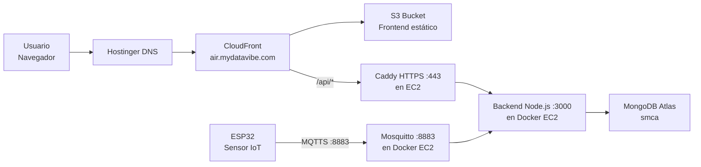
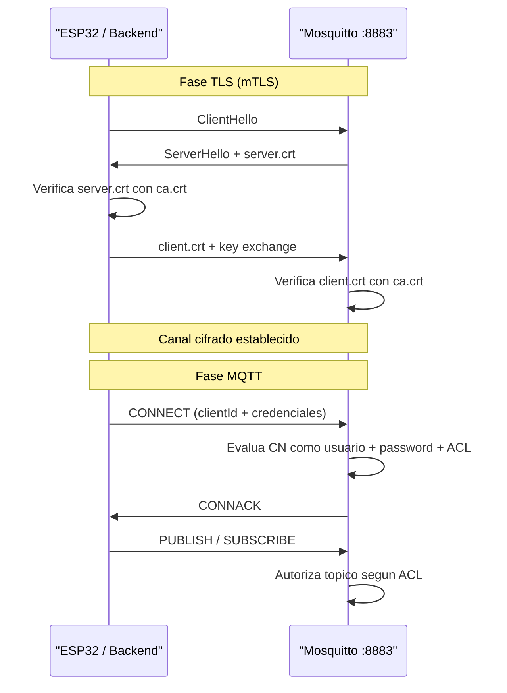
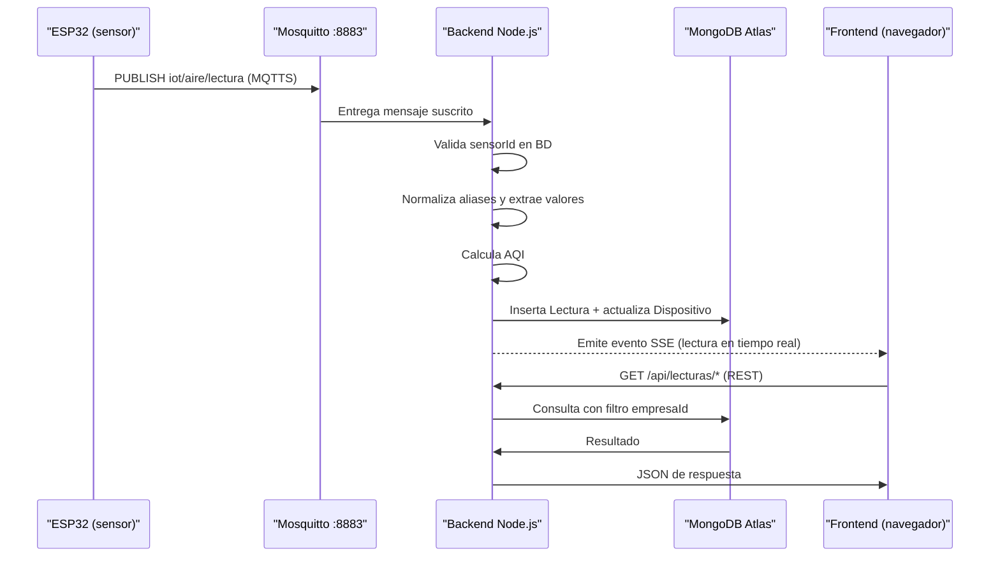

# Despliegue del Sistema — SMCA

**Sistema de Monitoreo de Calidad de Aire**
Trabajo Final — Maestría en Ingeniería de Sistemas IoT, UBA

---

## 1. Resumen de entornos

El sistema opera en dos entornos con arquitecturas diferentes:

| Componente | Local / Docker | Producción (AWS) |
|---|---|---|
| **Frontend** | Vite dev server (`:5173`) | Build estático en S3 + CDN CloudFront |
| **Backend** | Node.js en Docker (`:3000`) | Docker en EC2 (`:3000`) + Caddy HTTPS (`:443`) |
| **Base de datos** | MongoDB en Docker (`:27017`) | MongoDB Atlas (cloud gestionado) |
| **Broker MQTT** | Mosquitto en Docker (`:8883`) | Mosquitto en Docker dentro de EC2 (`:8883`) |
| **TLS API** | Sin TLS (desarrollo) | Let's Encrypt vía Caddy en EC2 |
| **TLS MQTT** | PKI propia (mTLS) | PKI propia (mTLS), mismos certificados |
| **DNS** | `localhost` | Hostinger DNS |

---

## 2. Arquitectura de producción

El sistema distribuye sus componentes entre servicios AWS, MongoDB Atlas y DNS externo:



### Roles de cada componente

| Componente | Servicio | Responsabilidad |
|---|---|---|
| **EC2** | AWS | Ejecuta Docker Compose con backend y Mosquitto |
| **S3** | AWS | Aloja los archivos estáticos del frontend compilado |
| **CloudFront** | AWS | CDN, terminación TLS del frontend; enruta `/api/*` al backend |
| **ACM** | AWS | Certificado TLS para el dominio de CloudFront |
| **MongoDB Atlas** | MongoDB | Base de datos gestionada, externa a EC2 |
| **Caddy** | Software en EC2 | Reverse proxy, terminación TLS para el backend (Let's Encrypt) |
| **Hostinger** | DNS externo | Gestión del dominio y registros DNS |

---

## 3. Contenedores Docker

### 3.1 Orquestación con Docker Compose

El archivo [`docker-compose.yml`](../docker-compose.yml) define tres servicios que comparten la red `smca_net` (driver bridge):

```yaml
services:
  mongo:       # Solo para desarrollo local
  mosquitto:   # Broker MQTT con TLS
  backend:     # API Node.js
```

En producción, el servicio `mongo` se elimina del Compose porque la base de datos es MongoDB Atlas. Solo se despliegan `backend` y `mosquitto` en EC2.

```
smca_net (bridge)
┌─────────────────────────────────────────────────┐
│  mongo        ← mongodb://mongo:27017           │
│  mosquitto    ← mqtts://mosquitto:8883          │
│  backend      ← http://backend:3000             │
└─────────────────────────────────────────────────┘
```

Los servicios se alcanzan entre sí usando sus nombres de contenedor como DNS interno de Docker.

### 3.2 Imagen: mosquitto

**Archivo:** [`mqtt/DockerFile`](../mqtt/DockerFile)

```dockerfile
FROM eclipse-mosquitto:2.0
EXPOSE 1883 8883
```

**Montajes en tiempo de ejecución (desde `docker-compose.yml`):**

| Origen (host) | Destino (contenedor) | Modo |
|---|---|---|
| `./mqtt/config/` | `/mosquitto/config/` | read-only |
| `./mqtt/certs/` | `/mosquitto/certs/` | read-only |
| volumen `mosquitto_data` | `/mosquitto/data` | persistente |
| volumen `mosquitto_log` | `/mosquitto/log` | persistente |

La configuración completa del broker (TLS, ACL, passwords) se carga desde los archivos montados, sin estar hardcodeada en la imagen.

### 3.3 Imagen: backend

**Archivo:** [`backend/DockerFile`](../backend/DockerFile)

```dockerfile
FROM node:18
WORKDIR /app
RUN mkdir -p ./certs
COPY ./src ./src
COPY .env .env
COPY package*.json ./
RUN npm install
EXPOSE 3000
CMD ["node", "src/server.js"]
```

**Montajes en tiempo de ejecución:**

| Origen (host) | Destino (contenedor) | Propósito |
|---|---|---|
| `./backend/certs/` | `/app/certs/` | Certificados TLS del cliente MQTT (backend) |
| `./mqtt/certs/` | `/mqtt/certs/` | Acceso adicional a la PKI completa (read-only) |

**Variables de entorno:** se cargan desde `./backend/.env` vía `env_file` en el Compose.

### 3.4 Imagen: frontend (solo desarrollo)

**Archivo:** [`frontend/DockerFile`](../frontend/DockerFile)

```dockerfile
FROM node:18
WORKDIR /app
COPY package*.json ./
RUN npm install
COPY . .
EXPOSE 5173
CMD ["npm", "run", "dev"]
```

Este Dockerfile ejecuta el servidor de desarrollo de Vite. **No se usa en producción**: en producción el frontend se compila con `npm run build` y los archivos de `dist/` se suben a S3.

---

## 4. Variables de entorno

### 4.1 Backend (`backend/.env`)

Basado en [`backend/env.example`](../backend/env.example):

| Variable | Valor de ejemplo | Descripción |
|---|---|---|
| `PORT` | `3000` | Puerto HTTP del servidor Express |
| `APP_TIMEZONE` | `America/Argentina/Buenos_Aires` | Zona horaria IANA para agregaciones MongoDB (`$dateTrunc`) y criterio de día calendario. No confundir con la región AWS del servidor |
| `MONGODB_URI` | `mongodb://mongo:27017/smca` (local) / `mongodb+srv://...` (Atlas) | URI completa de conexión a MongoDB |
| `MQTT_HOST` | `mqtts://mosquitto:8883` | URL del broker MQTT con TLS |
| `MQTT_TOPIC` | `iot/aire/lectura` | Tópico de suscripción para lecturas de sensores |
| `MQTT_TOPIC_LWT` | `iot/aire/status` | Tópico LWT (Last Will and Testament) para estado de dispositivos |
| `CLIENT_ID` | `backend_smca` | ID del cliente MQTT del backend; debe coincidir con el CN del certificado cliente y con las entradas en `passwords` y `acl` |
| `CA_CERT` | `./certs/ca.crt` | Ruta al certificado de la CA raíz (dentro del contenedor) |
| `CLIENT_CERT` | `./certs/client.crt` | Ruta al certificado cliente del backend |
| `CLIENT_KEY` | `./certs/client.key` | Ruta a la clave privada del certificado cliente |
| `JWT_SECRET` | — | Secreto para firmar tokens JWT. **Requerido pero ausente en `env.example`**; debe agregarse manualmente al `.env` |

### 4.2 Frontend (`frontend/.env` o variable de build)

| Variable | Valor de ejemplo | Descripción |
|---|---|---|
| `VITE_API_URL` | `https://smca.mydatavibe.com` | URL base del backend; necesaria al compilar para producción |

En desarrollo, si `VITE_API_URL` no está definida, `vite.config.js` usa `http://127.0.0.1:3000` como destino del proxy.

### 4.3 Script de generación de certificados (`../.env.local`)

Leído por [`mqtt/generate_certs_v2.sh`](../mqtt/generate_certs_v2.sh):

| Variable | Descripción |
|---|---|
| `MQTT_HOST` | Host o URL del broker (ej. `mqtts://mosquitto:8883` o IP pública de EC2) |
| `DEVICES` | Lista separada por espacios de IDs de dispositivos a certificar (ej. `"backend_smca nodo01 nodo02"`) |
| `CERT_DAYS` | Vigencia de los certificados en días (default: `365`) |
| `C`, `ST`, `L`, `O` | Campos X.509 del sujeto (país, provincia, localidad, organización) |

---

## 5. MQTT con TLS mutuo (mTLS)

El broker Mosquitto requiere autenticación bidireccional: tanto el servidor como cada cliente presentan un certificado firmado por la misma CA raíz. Esta es la capa de seguridad principal para la comunicación IoT.

### 5.1 Estructura de la PKI

```
mqtt/certs/
├── ca/
│   ├── ca.crt          ← Certificado raíz (compartido con todos los clientes)
│   └── ca.key          ← Clave privada de la CA (solo en el servidor, nunca se distribuye)
├── server/
│   ├── server.crt      ← Certificado del broker (CN=mosquitto, SAN=mosquitto+IP)
│   └── server.key      ← Clave privada del broker
└── clients/
    ├── backend_smca/
    │   ├── client.crt  ← Certificado del backend (CN=backend_smca, EKU=clientAuth)
    │   └── client.key
    ├── nodo01/
    │   ├── client.crt  ← Certificado del ESP32 nodo01 (CN=nodo01, EKU=clientAuth)
    │   └── client.key
    └── nodo02/
        ├── client.crt
        └── client.key
```

### 5.2 Generación de certificados

El script [`mqtt/generate_certs_v2.sh`](../mqtt/generate_certs_v2.sh) automatiza la creación de toda la PKI con OpenSSL:

```bash
# Ejecutar desde el directorio mqtt/
cd mqtt
bash generate_certs_v2.sh
```

El script realiza los siguientes pasos:

1. **CA raíz**: genera `ca.key` + `ca.crt` (si no existen). CN = `SMCA-Dev-CA`.
2. **Certificado servidor**: genera `server.key`, `server.csr` y `server.crt` firmado por la CA. CN = `mosquitto`; SAN incluye `DNS:mosquitto` y, si `MQTT_HOST` es una IP, también `IP:<ip>`.
3. **Certificados cliente**: por cada dispositivo en `$DEVICES`, genera `client.key`, `client.csr` y `client.crt` firmado por la CA. CN = device ID; EKU = `clientAuth`.
4. **CRL inicial**: genera una lista de revocación de certificados vacía (`ca/crl.pem`).

### 5.3 Configuración del broker (`mosquitto.conf`)

```conf
listener 8883
protocol mqtt

cafile   /mosquitto/certs/ca/ca.crt
certfile /mosquitto/certs/server/server.crt
keyfile  /mosquitto/certs/server/server.key

require_certificate      true   # mTLS obligatorio
use_identity_as_username true   # CN del cert = username MQTT

allow_anonymous false
password_file /mosquitto/config/passwords
acl_file      /mosquitto/config/acl

log_dest stdout
log_type all
```

Con `use_identity_as_username true`, el broker extrae el **CN del certificado cliente** como nombre de usuario MQTT. Esto unifica la autenticación TLS con el sistema de ACL: no es posible conectarse con un username diferente al CN del certificado.

### 5.4 Secuencia de conexión TLS + MQTT



### 5.5 Distribución de certificados por actor

| Actor | Archivos necesarios | Ubicación |
|---|---|---|
| **Broker Mosquitto** | `ca/ca.crt`, `server/server.crt`, `server/server.key` | Montados en `/mosquitto/certs/` |
| **Backend Node.js** | `ca/ca.crt`, `clients/backend_smca/client.crt`, `clients/backend_smca/client.key` | Copiados a `backend/certs/` como `ca.crt`, `client.crt`, `client.key` |
| **ESP32** | `ca/ca.crt`, `clients/nodoXX/client.crt`, `clients/nodoXX/client.key` | Embebidos en el firmware (flash) |

### 5.6 Tópicos MQTT

| Tópico | Dirección | Descripción |
|---|---|---|
| `iot/aire/lectura` | ESP32 → Broker → Backend | Payload JSON con mediciones ambientales |
| `iot/aire/status` | ESP32 → Broker → Backend | LWT: dispositivo se desconecta abruptamente |

**Formato del payload de lectura:**

```json
{
  "sensorId": "nodo01",
  "zona": "Planta A",
  "timestamp": "2026-04-19T14:30:00Z",
  "pm25": 35.4,
  "pm10": 48.2,
  "co2": 612,
  "temperatura": 23.1,
  "humedad": 58.0
}
```

El backend normaliza aliases (`temp` → `temperatura`, `hum` → `humedad`) y almacena solo los campos numéricos presentes en el campo `valores` (Map) de la colección `lecturas`.

---

## 6. Frontend: build y despliegue en S3 / CloudFront

### 6.1 Build de producción

```bash
cd frontend

# Definir la URL del backend antes de compilar
export VITE_API_URL=https://smca.mydatavibe.com

# Compilar
npm run build
# Genera: frontend/dist/ (HTML, JS, CSS, assets)
```

Vite embebe `VITE_API_URL` en el bundle durante la compilación. Si el valor cambia, es necesario recompilar y re-desplegar.

### 6.2 Proxy en desarrollo vs producción

El archivo [`frontend/vite.config.js`](../frontend/vite.config.js) configura un proxy para el servidor de desarrollo:

```js
proxy: {
  '/api/sse': { target: API_URL, /* SSE: deshabilita buffering */ },
  '/api':     { target: API_URL }
}
```

Este proxy **solo funciona en desarrollo** (`npm run dev`). En producción, el routing de `/api/*` hacia el backend es responsabilidad de **CloudFront** (behavior rules), no del frontend.

### 6.3 Configuración de CloudFront

La distribución CloudFront tiene dos comportamientos:

| Path Pattern | Origen | Descripción |
|---|---|---|
| `Default (*)` | S3 bucket | Sirve los archivos estáticos del frontend |
| `/api/*` | `smca.mydatavibe.com` (EC2) | Reenvía las llamadas a la API al backend |

**TLS del frontend**: el certificado HTTPS de `air.mydatavibe.com` se gestiona en **AWS ACM** (Certificate Manager) y se asocia a la distribución CloudFront. No requiere renovación manual.

### 6.4 Proceso de actualización del frontend

```bash
# 1. Compilar con la variable de entorno correcta
VITE_API_URL=https://smca.mydatavibe.com npm run build

# 2. Sincronizar el contenido de dist/ con el bucket S3
aws s3 sync frontend/dist/ s3://<nombre-del-bucket>/ --delete

# 3. Invalidar la caché de CloudFront para que sirva la nueva versión
aws cloudfront create-invalidation \
  --distribution-id <DISTRIBUTION_ID> \
  --paths "/*"
```

---

## 7. Backend en EC2

### 7.1 Composición en producción

En producción, el `docker-compose.yml` se ejecuta **sin el servicio `mongo`** (que se reemplaza por MongoDB Atlas). Solo se levantan `backend` y `mosquitto`:

```bash
# En EC2, después de clonar el repo y configurar el .env
docker compose up -d backend mosquitto
```

### 7.2 Caddy como reverse proxy

**Caddy** se ejecuta directamente en el host de EC2 (no en Docker) como reverse proxy para el backend. Su rol es:

- Recibir HTTPS en el puerto `:443` para el dominio `smca.mydatavibe.com`.
- Gestionar automáticamente el certificado TLS vía **Let's Encrypt** (ACME).
- Hacer proxy inverso de todas las peticiones hacia `localhost:3000` (el backend en Docker).

**Ejemplo de `Caddyfile` (no incluido en el repositorio):**

```
smca.mydatavibe.com {
    reverse_proxy localhost:3000
}
```

Caddy renueva el certificado de forma automática; no requiere intervención manual.

### 7.3 Puertos publicados en EC2

| Puerto | Protocolo | Servicio | Acceso |
|---|---|---|---|
| `443` | HTTPS | Caddy (API) | Público |
| `8883` | MQTTS | Mosquitto | Público (ESP32) |
| `3000` | HTTP | Backend Node.js | Solo localhost (detrás de Caddy) |
| `1883` | MQTT sin TLS | Mosquitto | Cerrado / no expuesto en producción |

### 7.4 Variables de entorno en producción

El archivo `backend/.env` en EC2 debe configurar la URI de Atlas en lugar de la URI local:

```env
MONGODB_URI=mongodb+srv://<usuario>:<password>@<cluster>.mongodb.net/smca
MQTT_HOST=mqtts://localhost:8883
# En EC2, el backend se conecta al Mosquitto local (mismo host)
```

---

## 8. MongoDB Atlas

### 8.1 Conexión

El backend se conecta a Atlas mediante la URI definida en `MONGODB_URI`. Atlas gestiona TLS/SSL de forma transparente; no se necesitan certificados adicionales en el lado del cliente para la conexión a la base de datos.

```
mongodb+srv://<usuario>:<password>@<cluster>.mongodb.net/smca?retryWrites=true&w=majority
```

### 8.2 Configuración recomendada en Atlas

| Aspecto | Recomendación |
|---|---|
| **IP Allowlist** | Restringir a la IP Elástica de EC2 |
| **Usuario de BD** | Permisos mínimos: `readWrite` solo sobre la base `smca` |
| **Tier** | M0 (free) para desarrollo; M10+ para producción con carga |
| **Backups** | Activar backups automáticos en Atlas |
| **Alertas** | Configurar alerta de almacenamiento para la colección `lecturas` (mayor crecimiento) |

### 8.3 Diferencia entre entornos

| Entorno | `MONGODB_URI` | Servicio |
|---|---|---|
| Local | `mongodb://mongo:27017/smca` | Contenedor `mongo:6` en Docker Compose |
| Producción | `mongodb+srv://...mongodb.net/smca` | MongoDB Atlas cloud |

---

## 9. DNS y dominios

El sistema utiliza **Hostinger** para gestión de DNS con dos dominios:

| Dominio | Registro DNS | Destino | Servicio final |
|---|---|---|---|
| `air.mydatavibe.com` | `CNAME` → dominio CloudFront | CloudFront distribution | S3 (frontend estático) |
| `smca.mydatavibe.com` | `A` → IP Elástica de EC2 | EC2 | Caddy → Backend `:3000` |

### Flujo de resolución DNS

```
Usuario → air.mydatavibe.com
        → Hostinger DNS
        → CloudFront distribution (HTTPS, certificado ACM)
        → S3 (assets estáticos) | smca.mydatavibe.com/api/* (API)

ESP32   → smca.mydatavibe.com:8883
        → Hostinger DNS
        → IP Elástica EC2
        → Mosquitto (MQTTS)
```

---

## 10. Flujo extremo a extremo (E2E)

El dato recorre el sistema completo desde la medición física hasta el dashboard del usuario:



### Descripción paso a paso

1. **ESP32** mide los parámetros ambientales y publica un JSON en el tópico `iot/aire/lectura` vía MQTTS (puerto 8883) con su certificado cliente.
2. **Mosquitto** valida el certificado mTLS, extrae el CN como username, verifica ACL y entrega el mensaje al backend suscrito.
3. **Backend** (`mqttClient.js`) recibe el mensaje, busca el dispositivo en MongoDB por `sensorId`, rechaza la lectura si el dispositivo no existe.
4. El backend normaliza los campos del payload, calcula el **AQI** (`aqiCalculator.js`), resuelve el `zonaId` si falta, y persiste el documento `Lectura` en Atlas.
5. Actualiza `Dispositivo.ultimaLectura` y `Dispositivo.estado = 'activo'`.
6. Emite un **evento SSE** (`sseEmitter`) que el frontend recibe en tiempo real sin necesidad de polling.
7. El **frontend** también realiza consultas REST (`/api/lecturas/*`) para cargar datos históricos, estadísticas y vistas de zonas.

---

## 11. Pasos de despliegue

### 11.1 Despliegue local (primera vez)

```bash
# 1. Clonar el repositorio
git clone https://github.com/rodri-iot/SMCA.git
cd IoT_Sistema_Monitoreo_Calidad_Aire

# 2. Crear el archivo de configuración para el script de certificados
cat > .env.local <<EOF
MQTT_HOST=mqtts://mosquitto:8883
DEVICES="backend_smca nodo01 nodo02"
CERT_DAYS=365
C=AR
ST=CABA
L=CABA
O=FIUBA
EOF

# 3. Generar la PKI completa (CA + server + clientes)
cd mqtt && bash generate_certs_v2.sh && cd ..

# 4. Copiar los certificados del backend al directorio esperado
cp mqtt/certs/ca/ca.crt         backend/certs/ca.crt
cp mqtt/certs/clients/backend_smca/client.crt  backend/certs/client.crt
cp mqtt/certs/clients/backend_smca/client.key  backend/certs/client.key

# 5. Crear y configurar el archivo .env del backend
cp backend/env.example backend/.env
# Editar backend/.env: agregar MONGODB_URI y JWT_SECRET

# 6. Levantar todos los servicios
docker compose up --build
```

**Servicios disponibles tras el inicio:**

| Servicio | URL |
|---|---|
| Frontend (Vite dev) | `http://localhost:5173` |
| API REST | `http://localhost:3000/api` |
| MongoDB | `mongodb://localhost:27017/smca` |
| Mosquitto MQTTS | `mqtts://localhost:8883` |

### 11.2 Despliegue en producción (EC2)

```bash
# En EC2 (Ubuntu/Amazon Linux), con Docker instalado

# 1. Clonar el repositorio
git clone https://github.com/rodri-iot/SMCA.git
cd IoT_Sistema_Monitoreo_Calidad_Aire

# 2. Generar certificados apuntando al host público
cat > .env.local <<EOF
MQTT_HOST=<IP_PUBLICA_EC2>
DEVICES="backend_smca nodo01 nodo02"
CERT_DAYS=365
EOF
cd mqtt && bash generate_certs_v2.sh && cd ..

# 3. Copiar certs del backend
cp mqtt/certs/ca/ca.crt                        backend/certs/ca.crt
cp mqtt/certs/clients/backend_smca/client.crt  backend/certs/client.crt
cp mqtt/certs/clients/backend_smca/client.key  backend/certs/client.key

# 4. Configurar el .env de producción
cat > backend/.env <<EOF
PORT=3000
APP_TIMEZONE=America/Argentina/Buenos_Aires
MONGODB_URI=mongodb+srv://<usuario>:<pass>@<cluster>.mongodb.net/smca
MQTT_HOST=mqtts://mosquitto:8883
MQTT_TOPIC=iot/aire/lectura
MQTT_TOPIC_LWT=iot/aire/status
CLIENT_ID=backend_smca
CA_CERT=./certs/ca.crt
CLIENT_CERT=./certs/client.crt
CLIENT_KEY=./certs/client.key
JWT_SECRET=<secreto_seguro>
EOF

# 5. Levantar solo backend y mosquitto (sin mongo local)
docker compose up -d backend mosquitto

# 6. Instalar y configurar Caddy como reverse proxy
sudo apt install -y caddy
# Editar /etc/caddy/Caddyfile:
#   smca.mydatavibe.com {
#       reverse_proxy localhost:3000
#   }
sudo systemctl enable --now caddy
```

### 11.3 Actualización del frontend en S3

```bash
cd frontend

# Compilar apuntando al backend de producción
VITE_API_URL=https://smca.mydatavibe.com npm run build

# Subir a S3
aws s3 sync dist/ s3://<nombre-bucket>/ --delete

# Invalidar caché de CloudFront
aws cloudfront create-invalidation \
  --distribution-id <DISTRIBUTION_ID> \
  --paths "/*"
```

---

## 12. Seguridad: resumen de capas

| Capa | Mecanismo | Herramienta |
|---|---|---|
| **Transporte API** | HTTPS con TLS automático | Caddy + Let's Encrypt |
| **Transporte MQTT** | MQTTS con mTLS (PKI propia) | OpenSSL + Mosquitto |
| **Autenticación MQTT** | Certificado cliente + password + ACL | Mosquitto config |
| **Autenticación API** | JWT firmado con `JWT_SECRET` | jsonwebtoken |
| **Autorización API** | Filtrado por `empresaId` del token JWT | Middleware Express |
| **Base de datos** | Usuario con permisos mínimos + IP Allowlist | MongoDB Atlas |
| **CDN / Frontend** | HTTPS con certificado ACM | CloudFront + ACM |
